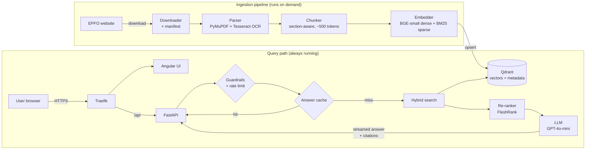
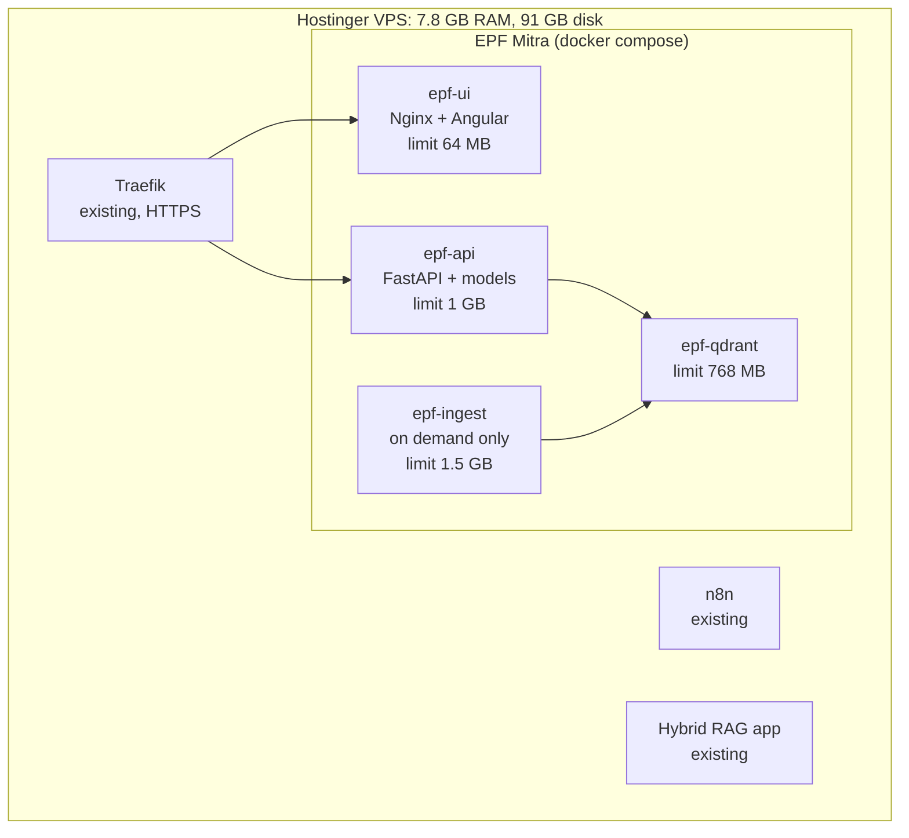

# Architecture: EPF Mitra (v1)

| Field | Value |
|---|---|
| Version | 0.1 |
| Date | 7 Nov 2026 |
| Related | [BRD](BRD.md) · [PRD](PRD.md) · [ADR-001](adr/ADR-001-tech-stack.md) |

EPF Mitra has two separate paths: an **ingestion pipeline** that runs only when documents change, and a **query path** that serves users all the time. Keeping them separate means the heavy work (parsing, OCR, embedding thousands of pages) never slows down the live demo.

## 1. System overview

## 2. Ingestion pipeline

| Step | What it does | Output |
|---|---|---|
| 1. Download | Fetches scheme documents, circulars and FAQs (2000 onwards) from the EPFO website, slowly and politely | PDFs in `data/raw/` + `manifest.json` (URL, title, date, SHA-256 hash) |
| 2. Parse | Extracts text and tables from digital PDFs; runs OCR on scanned pages; logs failures | Clean text per page in `data/processed/` |
| 3. Chunk | Splits by headings/sections first, then to ~500 tokens with 20% overlap | Chunks with metadata |
| 4. Embed | Creates a dense vector (meaning) and a sparse BM25 vector (keywords) per chunk | Two vectors per chunk |
| 5. Index | Upserts into Qdrant; skips chunks whose hash already exists | Searchable collection |

**Metadata stored with every chunk:** `doc_id`, `title`, `source_url`, `doc_type` (scheme / circular / FAQ), `published_date`, `page`, `section`, `chunk_index`, `content_hash`.

## 3. Query path

1. **Guardrails:** reject off-topic questions and prompt-injection attempts; enforce the limit of 10 questions per user per day.
2. **Cache:** if the same question (normalised) was answered before, return the cached answer with zero LLM cost.
3. **Hybrid search:** query Qdrant with both the dense and the sparse vector and merge the results (Reciprocal Rank Fusion), returning the top 20.
4. **Re-rank:** FlashRank scores the 20 candidates; newer documents get a small boost; keep the top 4.
5. **Relevance check:** if the best score is below a threshold, reply "I couldn't find this in the EPFO documents" without calling the LLM.
6. **Generate:** send the 4 passages (with dates) to GPT-4o-mini, telling it to answer only from them, prefer the newest rule, and cite each source.
7. **Stream:** send the answer to the Angular UI with Server-Sent Events, then send the citation list.

## 4. Deployment (shared VPS)

The VPS has 7.8 GB of RAM and 91 GB of free disk. Existing services (n8n, Traefik, Hybrid RAG app) use about 0.85 GB.

| Container | Memory limit | Runs |
|---|---|---|
| epf-ui | 64 MB | Always |
| epf-api | 1 GB | Always |
| epf-qdrant | 768 MB | Always |
| epf-ingest | 1.5 GB | Only during ingestion, then stops |
| **EPF Mitra always running** | **~1.8 GB** | |
| **Peak with ingestion + existing services** | **~4.2 GB of 7.8 GB** | Plus 2 GB swap as a safety net |

## 5. Security and privacy

- HTTPS through the existing Traefik.
- API keys in environment variables (`.env`, never committed).
- No login and no personal data stored; IP addresses are hashed before being used for rate limiting.
- Hard monthly spending cap on the LLM API account.

## 6. What comes in v2

LangGraph agent for multi-step questions, pension calculator, Tamil support, semantic answer cache, automatic ingestion of new circulars.
